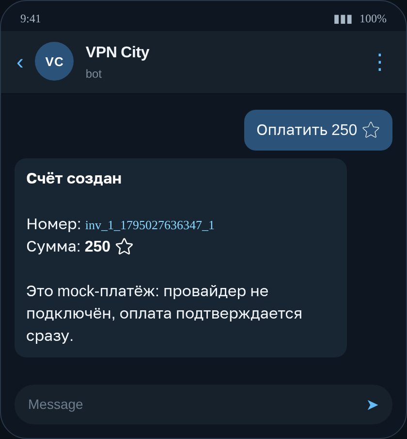

# VPN City

**Подписки на VPN с mock-биллингом и выдачей конфига в Telegram.**

[](#запуск)
[](#как-устроено)
[](#тесты)
[](#как-устроено)
[](LICENSE)

**[Открыть case study →](https://jefo.github.io/vpncity/)**



---

## Что это

Бот продаёт VPN-подписку: показывает тарифы, создаёт счёт, переводит подписку из `pending` в `active` и выдаёт конфиг. Оплата и выдача — демонстрационные, но домен, сценарий и тесты настоящие.

Это не «ещё один VPN-бот с кнопкой купить». Здесь есть отдельный слой подписок, платежей и конфигов. Telegram — только интерфейс.

---

## Что умеет

- Три тарифа: 1 месяц, 6 месяцев, 1 год.
- Цена в Telegram Stars и срок действия.
- Создание mock-счёта через payment gateway.
- Статусы подписки: `pending` → `active`.
- Выдача конфига после подтверждения оплаты.
- Статус подписки: тариф, дата окончания, остаток дней.
- Проверка истечения срока.
- 7 тестов на покупку, оплату и статус.

---

## Сценарий

```mermaid
flowchart TD
    A[/start] --> B[Меню]
    B -->|Купить VPN| C[Тарифы]
    C --> D[Карточка тарифа]
    D -->|Оплатить| E[Счёт]
    E --> F[Mock-платёж]
    F --> G[Подписка active]
    G --> H[VPN-конфиг]
    B -->|Моя подписка| I[Статус и срок]
```

---

## Запуск

Нужен [Bun](https://bun.com) и токен от [@BotFather](https://t.me/BotFather).

```bash
bun install
cp .env.example .env
```

В `.env`:

```env
BOT_TOKEN=123456:AA...
```

```bash
bun run start
```

Проверки:

```bash
bun test
bunx tsc --noEmit
```

---

## Структура

```text
src/
├── domain/
│   ├── plans.ts
│   ├── subscription.ts
│   ├── payment.ts
│   ├── vpn-config.ts
│   └── user.ts
├── app/
│   ├── ports.ts
│   └── use-cases.ts
├── infra/
│   ├── in-memory-store.ts
│   ├── mock-payment.ts
│   ├── mock-vpn.ts
│   └── composition.ts
└── telegram/
    ├── bot.ts
    └── views.ts
```

---

## Как устроено

- **Домен** не знает про Telegram. Тариф, подписка, счёт и конфиг — обычные типы.
- **Use cases** принимают порты: `CityStore`, `PaymentGateway`, `VpnProvider`.
- **Инфраструктура** подставляет in-memory хранилище и mock-реализации.
- **Telegram** только вызывает use cases и рисует экраны.

Поток покупки:

```text
buySubscription()
  → подписка pending
  → invoice pending
confirmPayment()
  → invoice completed
  → подписка active
  → VPN-конфиг создан
getStatus()
  → тариф, срок, остаток дней, наличие конфига
```

---

## Тесты

```text
7 pass
0 fail
19 expect() calls
```

Проверяется:

- список тарифов;
- создание pending-подписки и счёта;
- активация после оплаты;
- выдача конфига;
- статус с остатком дней;
- пустой статус для неизвестного пользователя;
- повторная оплата одного счёта.

---

## Документы

- [`docs/pilot-scope.md`](docs/pilot-scope.md) — MBSE-документ пилота.
- [`docs/risk-assessment.md`](docs/risk-assessment.md) — технические риски.
- [`docs/host-requirements.md`](docs/host-requirements.md) — требования к серверу.
- [`docs/openvpn-tuning.md`](docs/openvpn-tuning.md) — настройка OpenVPN под скорость.

Это материалы проекта, а не реклама. Цифры пилота (20 000 пользователей) — проектные допущения, не измеренный результат.

---

## Ограничения

- **Оплата mock.** Telegram Payments/Stars не подключены.
- **База in-memory.** Подписки и счета сбрасываются при перезапуске.
- **Конфиг mock.** Это не рабочий VPN-сервер.
- **Одна подписка на пользователя.** Продление отдельным сценарием не сделано.
- **Нет вебхука платежей.** Подтверждение происходит в том же обработчике.
- **Нет идемпотентности.** Повторный запрос оплаты обрабатывается как ошибка.

---

## Что дальше

- Подключить Telegram Payments или Stars с реальным провайдером.
- Перенести пользователей, счета и подписки в Postgres.
- Генерировать WireGuard/OpenVPN-конфиг на сервере.
- Добавить продление и отзыв доступа по окончании срока.
- Сделать вебхук платежей и идемпотентные операции.

---

## Лицензия

MIT.
